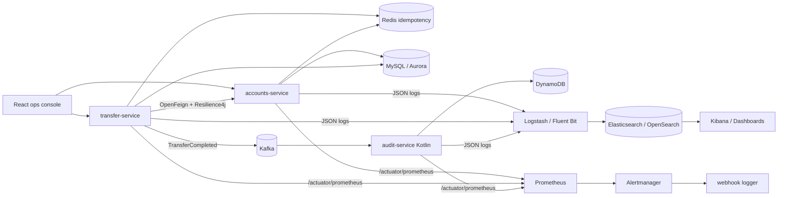

# core-banking-ledger

[](https://github.com/mini4141/core-banking-ledger/actions/workflows/ci.yml)

A slice of an in-house core banking system. Spring Boot microservices for accounts and transfers, a Kotlin audit service, Kafka, Redis, MySQL/Aurora, DynamoDB, ELK/OpenSearch, Prometheus alerting, deployed to Kubernetes with Helm and ArgoCD.

- Proof (screenshots, logs, test reports): [proof/README.md](proof/README.md)
- Portfolio write-up: [docs/PORTFOLIO.md](docs/PORTFOLIO.md)
- Progress and decisions: [PROGRESS.md](PROGRESS.md), [docs/DECISIONS.md](docs/DECISIONS.md)

## Architecture



PlantUML sources: [docs/diagrams](docs/diagrams) (rendered to SVG in CI). Architecture decisions: [docs/adr](docs/adr). Runbooks: [docs/runbooks](docs/runbooks).

| Part | Stack |
|---|---|
| `services/accounts-service` | Java 21, Spring Boot 3.5, JPA, Flyway, Redis cache |
| `services/transfer-service` | Java 21, OpenFeign, Resilience4j, Redis idempotency, Spring Kafka |
| `services/audit-service` | Kotlin, Spring Kafka (manual ack), DynamoDB |
| `ops-console` | React + Vite, served by nginx |

## Quickstart (local, Docker only)

Prerequisites: JDK 21, Docker, Node.js 24, k6 (for load tests).

```bash
scripts/dev-up.sh        # builds images with Jib, starts the compose stack, seeds demo data
scripts/test-all.sh      # unit, WireMock, integration, Playwright, k6
scripts/dev-down.sh
```

| UI | URL |
|---|---|
| Ops console | http://localhost:3000 |
| Kibana | http://localhost:5601 |
| Grafana | http://localhost:3001 (admin/admin) |
| Prometheus / Alertmanager | http://localhost:9090 / http://localhost:9093 |
| Swagger | http://localhost:8081/swagger-ui, http://localhost:8082/swagger-ui |

`scripts/drill-accounts-down.sh` stops accounts-service so the circuit opens and `TransferCircuitOpen` fires, then restores it.

## Kubernetes (kind + ArgoCD)

```bash
scripts/kind-up.sh       # kind cluster, ArgoCD, Strimzi, kube-prometheus-stack, Elasticsearch/Kibana, Fluent Bit, the app
MODE=k8s scripts/drill-accounts-down.sh
scripts/kind-down.sh
```

## AWS (EKS) deploy and destroy

Deployment runs from the maintainer's PC; GitHub Actions never holds AWS credentials. Everything is created by Terraform in `infra/` and tagged `Project=core-banking-ledger`, `Ephemeral=true`.

```bash
scripts/deploy.sh        # Terraform, ECR push, ArgoCD + platform, smoke/e2e/drill/k6
scripts/destroy.sh       # idempotent teardown
scripts/verify-destroyed.sh
```

Approximate cost of one showcase session (under 2 hours): see [docs/PORTFOLIO.md](docs/PORTFOLIO.md).

## Repository layout

```
services/   accounts-service, transfer-service, audit-service (Gradle multi-project)
ops-console/  React + Vite, Playwright e2e
local/      docker-compose stack (mysql, redis, kafka, dynamodb-local, ELK, prometheus, grafana, alertmanager)
deploy/     helm/core-banking (umbrella chart), argocd/ (Applications), platform/, kind/
infra/      Terraform (VPC, EKS, Aurora Serverless v2, DynamoDB, OpenSearch, ECR, Pod Identity)
loadtest/   k6
tests/      HTTP integration test against the compose stack
docs/       adr, diagrams, runbooks, performance-tuning.md
scripts/    dev-up/down, seed, test-all, capture-proof, kind-up, deploy, destroy, verify-destroyed
```
