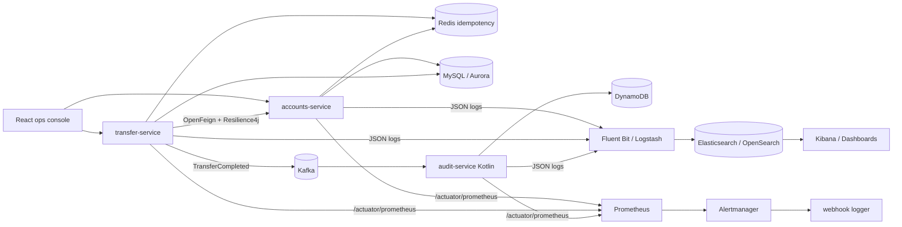

# SPECS.md: Core Banking Ledger

## 1. Summary

A slice of a next-generation **in-house core banking system**, made of four parts:

| Part | Stack | Job |
|---|---|---|
| `accounts-service` | Java 21 | Owns accounts and balances in MySQL (Flyway) |
| `transfer-service` | Java 21 | Orchestrates money movement by calling accounts through OpenFeign, protected by Resilience4j, with idempotency in Redis |
| `audit-service` | Kotlin | Consumes Kafka events into DynamoDB |
| React ops console | React | Operators open accounts, make transfers and watch the circuit-breaker state |

Logs flow to ELK (OpenSearch in AWS), and metrics and alerts flow through Prometheus/Alertmanager. It deploys to EKS through ArgoCD.

**Demo story:**
1. Open two accounts and transfer ¥10,000. The audit trail appears in DynamoDB and the logs in Kibana.
2. Replay the same request: idempotent.
3. Take accounts-service down. The circuit opens, transfers fail fast, and an alert fires.
4. Bring it back and everything recovers.
5. A k6 run shows the tuned throughput.

## 2. Requirement coverage matrix

| Requirement | Covered by | Proof |
|---|---|---|
| Backend in Java/Kotlin for core banking | Java services + Kotlin audit | CI |
| Performance and stability, high reliability | Resilience4j, optimistic locking, idempotency, perf tuning doc | k6 + drill logs |
| Use infrastructure to solve system challenges | Redis cache/idempotency, Kafka decoupling, Aurora Serverless, OpenSearch | Architecture |
| Architecture design + middleware selection | `docs/adr/*` (Kafka vs SQS, Redis idempotency, DynamoDB for audit) | Docs |
| Performance tuning, monitoring settings, alert response for microservices | Tuning doc, Prometheus rules, runbooks, drill | Logs |
| Spring Boot, JUnit, Resilience4j, Feign | Used | Tests |
| MySQL/Aurora, DynamoDB, ELK, Kafka, Redis | Used | Logs/screenshots |
| Docker, Kubernetes, ArgoCD, AWS | kind/EKS + ArgoCD | Screenshots |
| GitHub, Gradle, Maven, npm/yarn, Flyway | Gradle (+ npm for the console), Flyway | CI |
| PlantUML, draw.io, Miro | PlantUML diagrams | SVGs |
| DB schema design (RDB + NoSQL), efficient queries | MySQL schema + indexes, DynamoDB key design (`PK=ACCOUNT#id`, `SK=TS#…`) | Doc |
| Security considerations | Input validation, no PII in logs, least-privilege IAM, secrets from K8s Secrets | Code |
| RESTful API, Pub/Sub, DB clients (preferred) | REST + Kafka + JPA/DynamoDB clients | — |

## 3. Architecture



## 4. Repository layout

```
services/accounts-service/  services/transfer-service/  services/audit-service/ (Kotlin)
ops-console/                React + Vite (npm)
build.gradle.kts  settings.gradle.kts  gradle/libs.versions.toml
local/                      docker-compose.yml (mysql, redis, kafka, dynamodb-local, elasticsearch, logstash, kibana, prometheus, grafana, alertmanager)
deploy/helm/core-banking/   umbrella chart (services, console, ServiceMonitors, PrometheusRules)
deploy/argocd/              app manifests (templated)
deploy/platform/            strimzi, kube-prometheus-stack, fluent-bit values
infra/                      Terraform
docs/                       adr/, diagrams/*.puml, runbooks/, performance-tuning.md
loadtest/                   k6 scripts
```

## 5. Features (end-to-end)

### F1: Accounts
- `POST /accounts {customerName, currency}`, `GET /accounts/{id}`, `POST /accounts/{id}/deposit`, plus the internal legs `POST /internal/accounts/{id}/debit` and `/credit` with `{transferId, leg, amount}`.
- Flyway `V1__accounts.sql`. Balance reads are cached in Redis and evicted on writes.
- **Accept:** an account is created and a deposit shows the new balance.

### F2: Transfers
- `POST /transfers {idempotencyKey, fromAccountId, toAccountId, amount}` runs the orchestration in the project rules. `GET /transfers/{id}` and `GET /transfers?accountId=` round it out.
- **Accept:** a transfer moves funds, and a replay with the same key returns the same body without moving the money again.

### F3: Events and audit
- `TransferCompleted` goes to Kafka topic `banking.transfers`. The Kotlin audit-service consumes it with manual acks and writes to DynamoDB table `audit_events` (`PK = ACCOUNT#<id>`, `SK = TS#<iso>#<transferId>`). It also exposes `GET /audit/accounts/{id}`.
- **Accept:** both accounts have audit items after a transfer.

### F4: Resilience
- WireMock test: the accounts stub returns 500s, the breaker opens, and transfer-service answers 503 `ACCOUNTS_UNAVAILABLE` quickly.
- Drill on kind/EKS: `drill-accounts-down.sh` scales accounts-service to 0, then back up.
- **Accept:** the drill log shows the CLOSED → OPEN → HALF_OPEN → CLOSED transitions, and the alert fired then resolved.

### F5: Observability
- Logs are JSON with traceId and spanId (Micrometer tracing). Logstash or Fluent Bit ships them into the index `core-banking-*`. A Kibana saved search shows "transfer flow by traceId".
- The Grafana dashboard shows RPS, p95/p99 per endpoint, circuit state, Kafka consumer lag and the Hikari pool.
- Prometheus rules: `TransferCircuitOpen`, `TransferP99High`, `AuditConsumerLag`.
- **Accept:** screenshots of each.

### F6: Ops console (React)
- Pages: Accounts (list/create/deposit), Transfer form, Transfers list, Audit by account, System (circuit-breaker states from `/actuator/circuitbreakers`, service health).
- **Accept:** Playwright happy path.

### F7: Performance tuning
- k6 `transfer-load.js` (50 VUs, 2 minutes, thresholds p95 < 300 ms locally). It runs before and after the tuning changes, and the results go into `docs/performance-tuning.md`.

## 6. Data model

- **MySQL:**
  - `accounts(id, customer_name, currency, balance, version, created_at)`
  - `account_legs(id, account_id, transfer_id, leg, amount, created_at)` with UNIQUE(transfer_id, leg)
  - `transfers(id, idempotency_key UNIQUE, from_id, to_id, amount, status, created_at)` with an index on (from_id, created_at)
- **DynamoDB:** `audit_events(PK, SK, type, amount, counterparty, transferId)`
- **Redis:** `idem:<key>` (the result JSON, 24 h) and `bal:<accountId>`

## 7. Interfaces

The REST endpoints are listed in F1–F3. Every service also exposes `/actuator/health`, `/actuator/prometheus` and `/actuator/circuitbreakers`, plus OpenAPI through springdoc at `/swagger-ui`.

## 8. Test plan

| Layer | Test |
|---|---|
| JUnit | `TransferService` orchestrates debit+credit (mocks); balance arithmetic; Kotlin event→item mapper |
| Integration | Transfer → Kafka → audit item exists (compose or Testcontainers incl. DynamoDB Local) |
| WireMock | Breaker opens |
| e2e | Playwright console transfer |
| Load | k6 thresholds |

## 9. Phase 1: Local

Compose stack for development, then **kind + ArgoCD** (with the platform pieces: Strimzi, kube-prometheus-stack, a lightweight single-node Elasticsearch + Kibana or OpenSearch + Dashboards, and Fluent Bit) to prove Kubernetes and GitOps.

- [ ] `tests/`: JUnit XML (all modules), Playwright, k6 summary
- [ ] `screenshots/01-console-accounts.png`, `02-console-transfer.png`, `03-console-system-breaker-open.png`, `04-kibana-transfer-trace.png`, `05-grafana-dashboard.png`, `06-alertmanager-firing.png`, `07-argocd-kind.png`
- [ ] `logs/drill-accounts-down.log`, `logs/dynamodb-audit-scan.json`, `logs/flyway-migrate.log`, `docs/performance-tuning.md` (with numbers)

## 10. Phase 2: AWS

| Local | AWS |
|---|---|
| MySQL | Aurora MySQL Serverless v2 (private subnets, SG from nodes) |
| DynamoDB Local | DynamoDB table (on-demand), Pod Identity for audit-service |
| Kafka container | Strimzi Kafka (1 broker, ephemeral storage) on EKS |
| Redis container | Redis Deployment (official image) on EKS |
| Elasticsearch/Kibana | Amazon OpenSearch Service + Dashboards (domain access policy restricted to the Fluent Bit role and the deployer IP) |
| kind | EKS + ArgoCD |

`scripts/deploy.sh`:
1. `terraform apply`.
2. Push images (Jib) to ECR.
3. Install ArgoCD + platform apps.
4. Create the core-banking Application with parameters.
5. Wait for Healthy.
6. Smoke, Playwright, the drill and a k6 run (lighter).

- [ ] `screenshots/01-eks-console.png`, `02-eks-argocd.png`, `03-opensearch-dashboards-logs.png`, `04-eks-grafana.png`
- [ ] `logs/eks-drill-accounts-down.log`, `logs/aurora-describe.json`, `logs/dynamodb-scan.json`, `resources.txt`
- [ ] `tests/playwright-eks/`, `tests/k6-eks.txt`

## 11. Phase 3: Destroy

`destroy.sh`:
1. Delete the ArgoCD apps (cascade), the LB Service (wait for the NLB) and the Strimzi resources.
2. `terraform destroy`, waiting out the OpenSearch domain deletion.

`verify-destroyed.sh` checks for no EKS cluster, Aurora cluster, OpenSearch domain (`aws opensearch list-domain-names`), DynamoDB tables or ELBs, and that the VPC is gone.

## 12. Out of scope

Interest, loans, ATM integration, regulatory reporting, and multi-currency FX.
