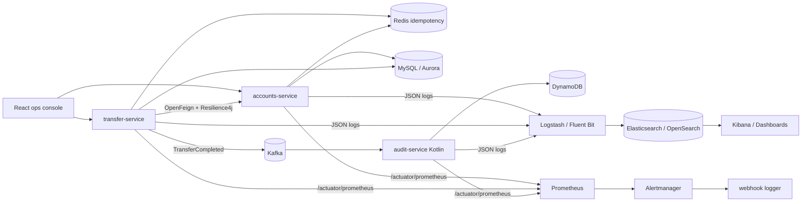
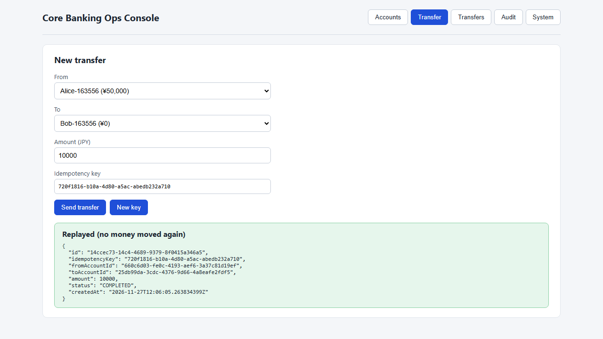
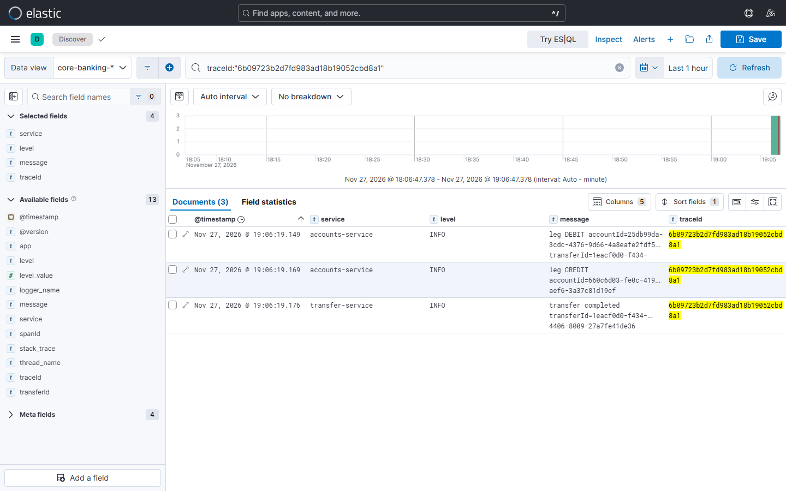
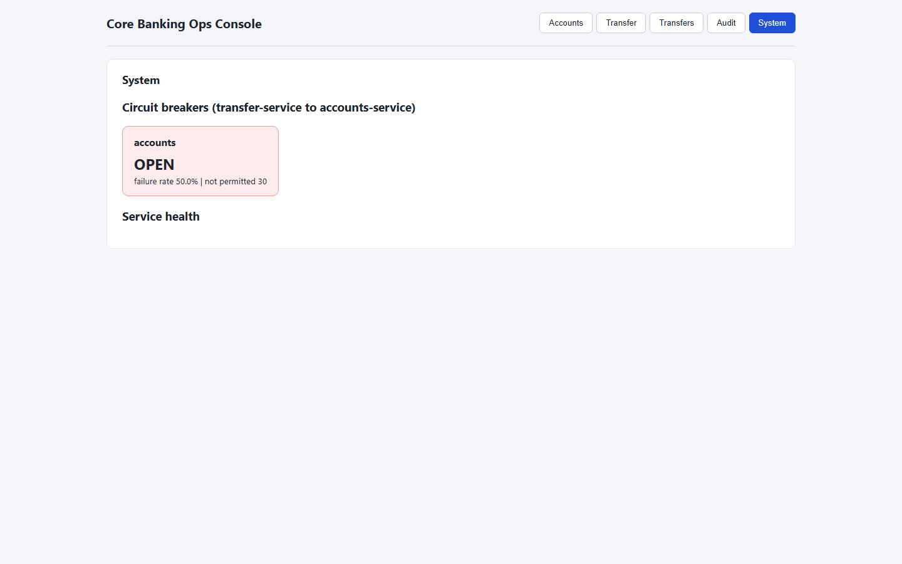
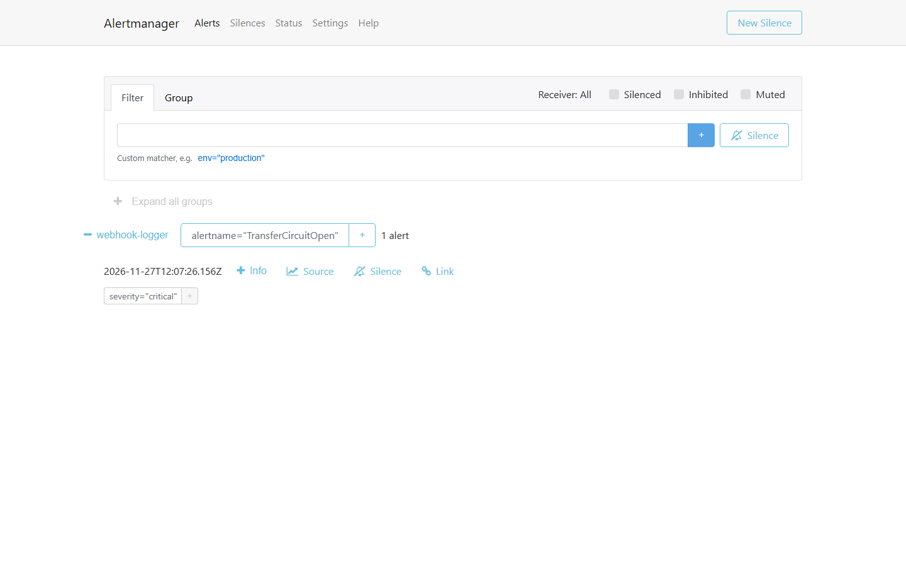
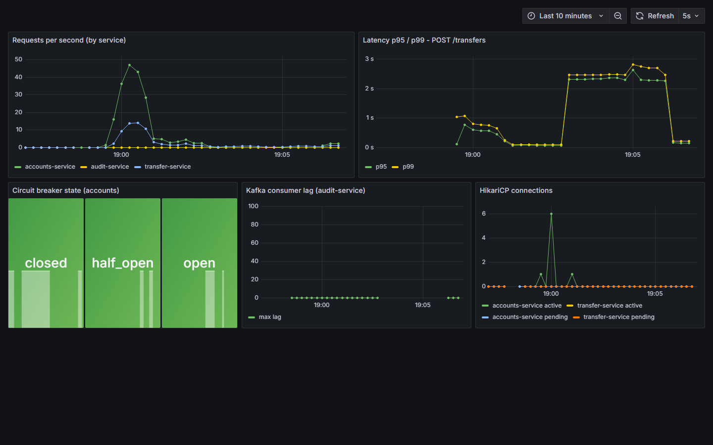
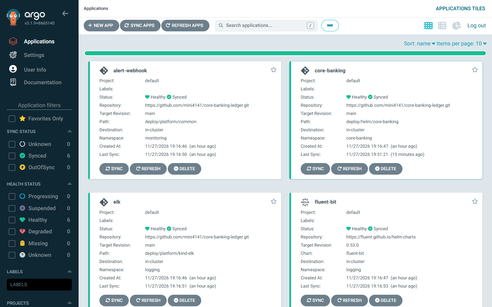
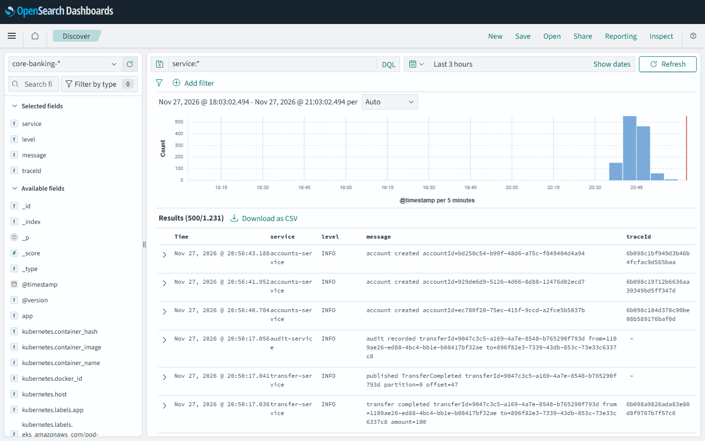
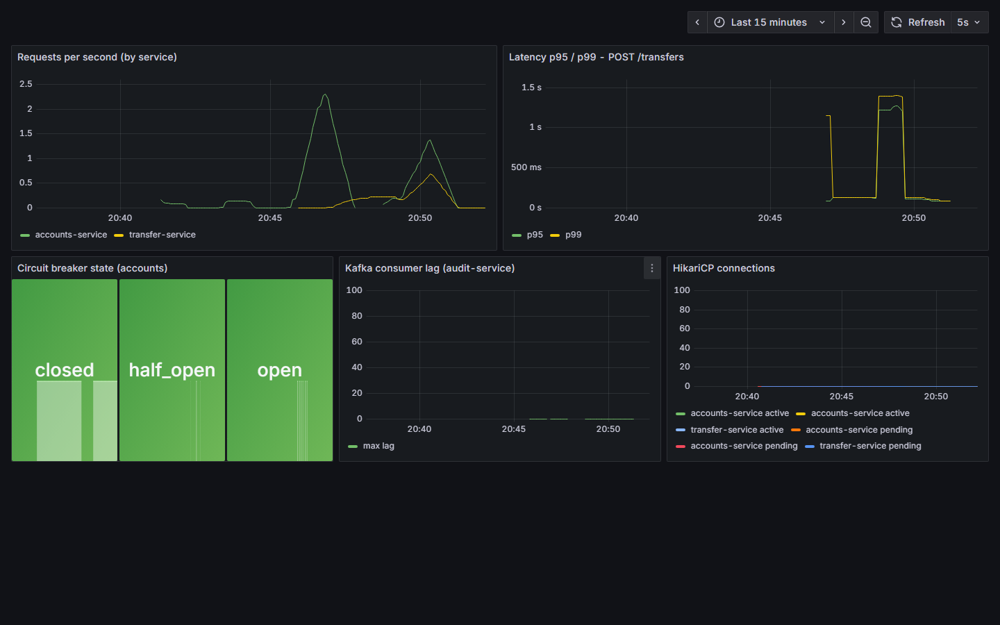

# Core Banking Ledger: Spring Boot microservices on Kubernetes

A slice of an in-house core-banking system, built end to end and proven twice: on a laptop (Docker Compose, then kind with Argo CD) and on AWS (EKS, Aurora Serverless v2, DynamoDB, OpenSearch), then torn down to zero. Code: [github.com/mini4141/core-banking-ledger](https://github.com/mini4141/core-banking-ledger).

## The problem

Moving money between accounts looks trivial and is not. Requests are retried, services fail halfway, two transfers touch the same balance at once, and every movement must be auditable. The slice answers four questions a core-banking backend has to answer:

1. **Never move money twice.** A replayed request must return the original result.
2. **Never lose half a transfer.** If crediting fails after debiting, the debit is compensated.
3. **Fail fast, recover by itself.** When the accounts service is down, transfers must answer immediately with a clear error, an alert must fire, and everything must heal when the service returns.
4. **Leave a trail.** Every transfer is audited asynchronously, logged with a trace ID, and measured.

## Architecture



The transfer flow (PlantUML source in [docs/diagrams](diagrams)): validate, claim the idempotency key in Redis (`SET NX`, 24 h), Feign `debit`, Feign `credit` (compensating `credit-back` on failure), persist, publish `TransferCompleted` to Kafka keyed by transfer ID, return. Accounts uses `@Version` optimistic locking and a unique `(transfer_id, leg)` constraint, so legs are idempotent even if Redis loses a key.

Design decisions are recorded as ADRs: [Kafka over SQS](adr/0001-kafka-over-sqs.md), [Redis for idempotency](adr/0002-redis-idempotency.md), [DynamoDB for the audit trail](adr/0003-dynamodb-audit.md). Schema design: [data-model.md](data-model.md). Security: [security.md](security.md).

## Stack against the requirement

| Requirement | Where it is in the project | Evidence |
|---|---|---|
| Java and Kotlin backend for core banking | `accounts-service` and `transfer-service` (Java 21, Spring Boot 3.5); `audit-service` (Kotlin) | CI, JUnit XML in `proof/phase1-local/tests/junit` |
| Spring Boot, Web, Data JPA, Kafka, Redis, Micrometer | all three services | tests, dashboards |
| OpenFeign + Resilience4j (circuit breaker, retry, bulkhead, rate limiter) | `AccountsGateway` in transfer-service | WireMock test, [drill log](../proof/phase1-local/logs/drill-accounts-down.log) |
| MySQL / Aurora, Flyway | schemas `accounts` and `transfers`, migrations V1 and V2 | [flyway log](../proof/phase1-local/logs/flyway-migrate.log), [Aurora describe](../proof/phase2-cloud/logs/aurora-describe.json) |
| DynamoDB | audit table, `PK=ACCOUNT#id`, `SK=TS#...` | [scan](../proof/phase2-cloud/logs/dynamodb-scan.json) |
| Redis | idempotency keys and balance cache | integration test, k6 tuning |
| Kafka (KRaft, Strimzi) | topic `banking.transfers`, manual-ack consumer | integration test, EKS pods |
| ELK / OpenSearch, Fluent Bit | Logstash locally; Fluent Bit to OpenSearch on AWS | screenshots 04 and 03 below |
| Prometheus, Grafana, Alertmanager, runbooks | dashboard, three alert rules, [runbooks](runbooks) | screenshots 05, 06; drills |
| Docker, Kubernetes, Helm, Argo CD | Jib images, umbrella Helm chart, kind and EKS, GitOps | screenshots 07 and 02 |
| AWS: EKS (spot), ECR, Aurora Serverless v2, DynamoDB, OpenSearch, IAM Pod Identity | Terraform in `infra/` | [resources.txt](../proof/phase2-cloud/resources.txt) |
| JUnit 5, WireMock, Playwright, k6 | one happy path per feature | [tests](../proof/phase1-local/tests), [EKS tests](../proof/phase2-cloud/tests) |
| Gradle, npm, GitHub Actions | Kotlin-DSL multi-project build, Vite console, CI on every push | green CI badge |
| Terraform, PlantUML | `infra/`, `docs/diagrams/*.puml` | CI renders the SVGs |
| Performance tuning, monitoring, alert response | [performance-tuning.md](performance-tuning.md), alert rules, drill | k6 before/after, drill logs |

## Proof

**The console, and idempotency.** A transfer completes; replaying the same key returns the same body without moving money again.



**One trace across three services.** Kibana filtered by a single `traceId` shows the accounts DEBIT and CREDIT legs and the transfer, from JSON logs of different services.



**Breaker open, alert firing.** With accounts-service down, the System page shows the breaker `OPEN`, and Alertmanager holds `TransferCircuitOpen`.




**Dashboards.**



**Argo CD on kind, and on EKS.**




**On AWS: logs from EKS in OpenSearch Dashboards, and Grafana on EKS.**




The alert drill (`scripts/drill-accounts-down.sh`) logs `CLOSED -> OPEN -> HALF_OPEN -> CLOSED`, the alert firing and resolving, and a fail-fast `503 ACCOUNTS_UNAVAILABLE` in 11 ms while the breaker was open: [compose](../proof/phase1-local/logs/drill-accounts-down.log), [kind](../proof/phase1-local/logs/kind-drill-accounts-down.log), [EKS](../proof/phase2-cloud/logs/eks-drill-accounts-down.log). Teardown evidence: [verify-destroyed.txt](../proof/phase3-destroy/verify-destroyed.txt).

## What was hard

These all showed up only when the system ran; each is in `docs/DECISIONS.md`.

- **Deadlocks under load.** The first tuned k6 run had 11 % failed transfers. MySQL reported deadlocks: inserting a leg took a shared lock through the foreign key before the balance update needed the exclusive lock. Updating the balance first fixed it, and the circuit breaker had opened for real along the way.
- **Honest performance numbers.** Throughput in the first minute of a JVM is under half of steady state, so every early comparison was noise. Adding a discarded warm-up run made the before/after stable: throughput doubled (28 to 56 iterations/s) and p95 fell from 1.94 s to 0.70 s. The local 300 ms target was not reached on a laptop running ELK next to the services, and the doc says so.
- **Logging that silently did nothing in Kubernetes.** Nesting a `springProfile` inside `root` is invalid Logback, which left pods without any appender. Compose always ran with the profile that hid it.
- **Kubernetes service links.** A Service named `redis` injects `REDIS_PORT=tcp://...`, which Spring tried to bind to an int. `enableServiceLinks: false`.
- **nginx and DNS, twice.** nginx caches upstream IPs (fixed with a re-resolving resolver), and its resolver ignores the pod's search domains (fixed with fully qualified service names).
- **A plain-HTTP load balancer breaks `crypto.randomUUID()`.** The console worked on localhost and went blank on the NLB.
- **Alertmanager config.** Replacing the chart's config left a route pointing at a receiver that no longer existed, so Alertmanager never started and no alert could fire.
- **Tooling drift.** `ubuntu-latest` moved to a release Playwright does not support; `gradlew` lost its executable bit on Windows; Docker Engine 29 rejects the API version Testcontainers 1.x uses (so the integration test runs against the compose stack).

## Cost

One showcase session, from `terraform apply` to a verified destroy, took roughly 1 h 05 min (13:18 to 14:23 UTC). At ap-southeast-2 list prices that is approximately: EKS control plane 0.11 USD, two spot t3.large nodes 0.08 USD, Aurora Serverless v2 at 0.5 ACU 0.08 USD, OpenSearch t3.small.search 0.06 USD, one NLB and public IPv4 addresses 0.08 USD, DynamoDB, ECR and data transfer a few cents. **About 0.5 USD in total** (an estimate from list prices, not from the bill). No NAT gateways, multi-AZ databases, provisioned IOPS or reserved capacity were used.

## Reproduce

```bash
scripts/dev-up.sh                 # compose stack + demo data
scripts/test-all.sh               # unit, WireMock, integration, Playwright, k6
scripts/capture-proof.sh phase1   # screenshots and logs into proof/phase1-local
scripts/kind-up.sh                # kind + Argo CD + platform + app
scripts/deploy.sh                 # AWS: Terraform, ECR, Argo CD, tests (profile core-banking-ledger-deployer)
scripts/capture-proof.sh phase2
scripts/destroy.sh && scripts/verify-destroyed.sh
```
